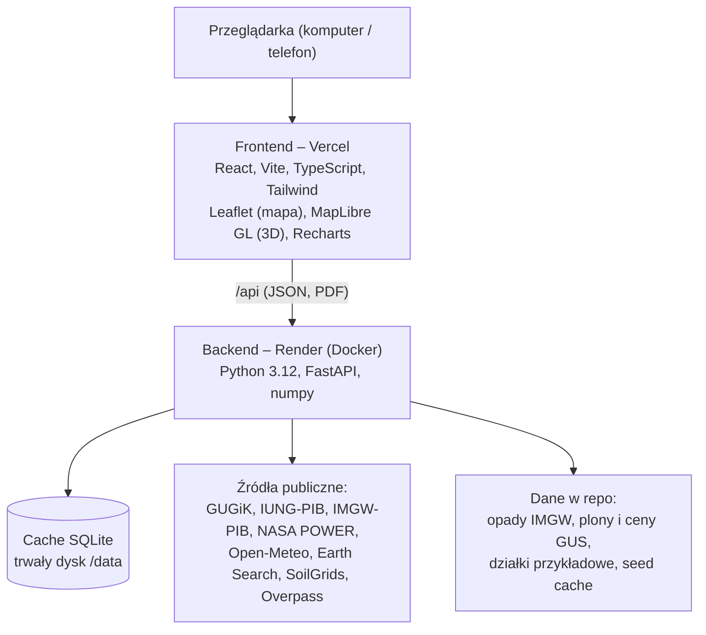

# Wodoskop – prześwietl swoją działkę pod kątem suszy

Zespół **Molekuły** · HackNation 2026 · zadanie Krajowego Ośrodka Wsparcia Rolnictwa (KOWR) „Zatrzymaj wodę”.

| | |
|---|---|
| Aplikacja | <https://wodoskop.vercel.app> |
| API | <https://wodoskop-api.onrender.com> (dokumentacja: `/docs`, stan źródeł: `/api/status`). Pierwsze wywołanie po bezczynności albo po wdrożeniu może trwać dłużej. |
| Film (do 3 min) | [LINK] |
| Prezentacja | [LINK] |
| Przykładowe raporty PDF | katalog [`reports/examples/`](reports/examples/) |

**Do szybkiego sprawdzenia** – wpisz numer działki na ekranie startowym albo otwórz link:

| Działka | Co to za przypadek | Link |
|---|---|---|
| `201305_2.0038.6/1` | Wnory-Wandy, woj. podlaskie – dobra gleba | <https://wodoskop.vercel.app/?dzialka=201305_2.0038.6/1> |
| `302408_5.0017.70/4` | Pożarowo, woj. wielkopolskie – słaby piasek | <https://wodoskop.vercel.app/?dzialka=302408_5.0017.70/4> |
| `060401_1.0268.421` | woj. lubelskie | <https://wodoskop.vercel.app/?dzialka=060401_1.0268.421> |

**Data historyczna:** na ekranie startowym obok pola numeru jest pole „Data analizy” (dziś albo dowolny dzień z ostatnich
10 lat). To samo w adresie: `?dzialka=201305_2.0038.6/1&data=2018-06-30`. Dla daty historycznej aplikacja używa tylko
danych sprzed tej daty (szczegóły i wyjątki – punkt 8).

## Spis treści

1. [Uruchomienie (4.2.1)](#1-uruchomienie-421)
2. [Funkcje (4.2.2)](#2-funkcje-422)
3. [Architektura (4.2.3)](#3-architektura-423)
4. [Źródła i zakresy danych (4.2.4, 5.3)](#4-źródła-i-zakresy-danych-424-53)
5. [Dane pobierane na bieżąco i pobrane wcześniej (4.2.5)](#5-dane-pobierane-na-bieżąco-i-pobrane-wcześniej-425)
6. [Biblioteki, usługi i narzędzia AI (4.2.6, 5.3)](#6-biblioteki-usługi-i-narzędzia-ai-426-53)
7. [Licencje (4.2.7)](#7-licencje-427)
8. [Znane ograniczenia (4.2.8)](#8-znane-ograniczenia-428)
9. [Weryfikacja wyników (4.2.9)](#9-weryfikacja-wyników-429)
10. [Skalowalność i koszty (5.5)](#10-skalowalność-i-koszty-55)
11. [Dostępność, bezpieczeństwo i dane osobowe (5.4, 5.6)](#11-dostępność-bezpieczeństwo-i-dane-osobowe-54-56)
12. [Zespół](#12-zespół)

## 1. Uruchomienie (4.2.1)

**Online (bez instalacji):** <https://wodoskop.vercel.app> – w przeglądarce na komputerze albo telefonie.

**Lokalnie** – wymagany tylko Docker (Docker Desktop na Windows / macOS, Docker Engine na Linuksie):

```bash
docker compose up --build
```

- aplikacja: <http://localhost:5173>
- API: <http://localhost:8000>, dokumentacja API: <http://localhost:8000/docs>
- stan źródeł danych: <http://localhost:8000/api/status>

Domyślnie wszystkie źródła danych są odpytywane na żywo (wyjątek: BDOT10k – nieużywane, patrz punkt 4). Pobrane dane
trafiają do cache w wolumenie Dockera (`cache-data`, plik `/data/cache.sqlite`) i przeżywają restart. Kluczy API ani
kont w zewnętrznych serwisach nie trzeba.

| Zmienna | Domyślnie | Do czego |
|---|---|---|
| `OFFLINE_SOURCES` | `bdot` | lista źródeł czytanych tylko z cache (klucze: `uldk`, `nmt`, `kieg`, `uug`, `bdot`, `prng`, `soil_map`, `ortho`). Przydaje się w sieci, która blokuje usługi GUGiK: `OFFLINE_SOURCES=uldk,nmt,kieg,uug,bdot` – wtedy działają działki przykładowe i te już pobrane. |
| `DEMO_OFFLINE` | `false` | `true` = żadnych zapytań zewnętrznych, wszystko z cache (pokaz bez internetu; działają działki przykładowe). |

```bash
# bash
OFFLINE_SOURCES="uldk,nmt,kieg,uug,bdot" docker compose up --build
DEMO_OFFLINE=true docker compose up --build
```

```powershell
# PowerShell
$env:OFFLINE_SOURCES="uldk,nmt,kieg,uug,bdot"; docker compose up --build
$env:DEMO_OFFLINE="true"; docker compose up --build
```

Przeglądarki: aktualne Chrome, Edge, Firefox, Safari (komputer i telefon). Widok 3D wymaga WebGL.

Testy: `docker compose exec backend pytest` (bez sieci; 5 testów na żywo: `pytest -m live`), frontend
`cd frontend && npm run build`. Publiczne wdrożenie (Vercel + Render): [DEPLOY.md](DEPLOY.md).

## 2. Funkcje (4.2.2)

**Wybór działki**
- numer z ewidencji (pełny identyfikator, np. `201305_2.0038.6/1`), „wieś numer” (np. `Szczytno 112/11`),
  „gmina numer”, adres (przybliża mapę – pole wybiera się kliknięciem), kliknięcie na mapie, „Moja lokalizacja”,
- własny obrys pola narysowany na mapie (gdy działka z ewidencji nie pasuje do pola),
- gdy ewidencja gruntów chwilowo nie odpowiada – wynik dla obszaru ok. 1 ha wokół wskazanego punktu, z wyraźną informacją.

**Parametry analizy**
- data analizy: dziś albo dowolny dzień z ostatnich 10 lat (tylko dane sprzed tej daty),
- okres podsumowania: ostatnie 30 dni, od siewu, sezon albo własny zakres (do roku),
- uprawa (15 upraw z metodyki IUNG), przedplon i historia pola (1–3 lata), planowane uprawy, powierzchnia uprawy,
  data siewu (w granicach ±30 dni od typowej).

**Wynik**
- werdykt działki w dwóch wierszach: „Teraz” (stopień braku wody: W normie / Uwaga / Mało wody / Bardzo mało wody –
  te same progi z uprawą i bez) i „Na dłuższą metę” (jak działka radzi sobie z suszą w wieloleciu),
- zapas wody w glebie (model FAO-56) – dziś, przebieg w sezonie i na tle tego samego dnia w 10 latach,
- bilans wody (opad minus parowanie) w sezonie i w wybranym okresie, historia 10 lat, dni stresu wodnego uprawy,
- ranking „Co tu posiać?” – 14 upraw polowych (+ wieloletnie osobno): plon typowy, plon w słabym roku, w ilu z 10 lat
  susza zabrałaby ponad 20% plonu, przychód z pola (gdzie jest cena skupu), widełki wyniku przy innych danych
  o opadach i pojemności gleby, płodozmian,
- działania w kolejności **retencja → agrotechnika → nawadnianie**, z informacją o formalnościach (zgłoszenie /
  pozwolenie) i ekoschematach; każda rekomendacja pokazuje dane, które ją uruchomiły,
- przyczyny wyniku, pewność (wysoka / średnia / ograniczona) z uzasadnieniem, źródło i data przy każdej liczbie,
  braki danych komunikowane wprost.

**Mapa**
- warstwy: Kondycja upraw i Wilgotność roślin (Sentinel-2), Teren (sucha górka / stok / płasko / obniżenie),
  Spływ wody (kierunki, miejsce odpływu, miejsce na oczko), Rowy i zbiorniki (OpenStreetMap + najbliższy wodowskaz
  IMGW), Gleba (kategorie podatności na suszę IUNG w obrysie działki), widok 3D terenu,
- podkład: ortofotomapa GUGiK.

**Dokumenty i inne**
- paszport wodny działki (pełny widok wyników) i raport PDF: skrócony (2 strony) i pełny,
- zgłoszenia stanu rowów i zbiorników: formularz, mapa zgłoszeń, potwierdzenia, pismo do pobrania (ciek → Wody
  Polskie, rów → właściciel / spółka wodna); nic nie jest wysyłane automatycznie, formularz nie zbiera danych osobowych,
- tryb Rolnik (prosty język) i Doradca (więcej liczb i uzasadnień od razu) – w Ustawieniach,
- przykłady na ekranie startowym: Dobra działka, Słaba ziemia, Stok na Pogórzu, Obniżenie z oczkiem, Susza na
  Kujawach, Stok na lessie.

## 3. Architektura (4.2.3)



Moduły backendu (`backend/app/`):

| Katalog | Rola |
|---|---|
| `sources/` | jeden moduł na źródło danych (pobranie i odczyt odpowiedzi, limit czasu, cache, bezpiecznik) |
| `analysis/` | obliczenia: ET0 (FAO-56), model wody w glebie, opad ze stacji, gleba, teren, ranking upraw i jego warianty, stopień braku wody, werdykt, rekomendacje; reguły i progi w `analysis/rules/*.yaml` |
| `routers/` | endpointy API (`/api/analysis`, `/api/search`, `/api/parcel`, `/api/satellite`, `/api/terrain`, `/api/hydro`, `/api/layers`, `/api/report.pdf`, `/api/infra-reports`, `/api/status`) |
| `report/` | raport PDF (WeasyPrint, szablon Jinja2) |
| `schemas/` | kontrakt API (Pydantic), odwzorowany w `frontend/src/api/types.ts` |

Jak to działa: źródła są pobierane równolegle, każde z limitem czasu i cache; awaria jednego obniża „pewność”
wyniku, ale nie przerywa analizy. Wolniejsze części – zdjęcie satelitarne, teren z NMT, rowy i zbiorniki, a przy
wolnej odpowiedzi także SoilGrids i widełki rankingu – liczą się w tle: wynik główny pokazuje się od razu, a te
sekcje dochodzą po chwili. Wynik rankingu jest pamiętany, więc zmiana uprawy albo okresu nie liczy go od nowa.

## 4. Źródła i zakresy danych (4.2.4, 5.3)

| Źródło | Dane | Zakres / rozdzielczość | Jak używane | Licencja / warunki |
|---|---|---|---|---|
| ULDK (GUGiK) | granice i powierzchnia działki ewidencyjnej | cała Polska | wyszukanie działki po numerze i po punkcie | usługa publiczna GUGiK, z podaniem źródła |
| NMT (GUGiK) | wysokości terenu | siatka 3–15 m w obrysie, dokładność ok. 0,1 m | spadki, strefy terenu, spływ, zagłębienia, miejsce na oczko | usługa publiczna GUGiK |
| Mapa glebowo-rolnicza (GUGiK, WMS) | kompleks przydatności rolniczej, gatunek gleby | 9 punktów w obrysie; mapa z lat 1960–1980 | dobór upraw do gleby, kontrola zgodności z IUNG | usługa przeglądania GUGiK |
| EGiB / KIEG (GUGiK) | klasy bonitacyjne | tylko część powiatów | informacyjnie (nie wchodzi do obliczeń) | usługa publiczna GUGiK |
| PRNG, UUG / PRG (GUGiK) | miejscowości, obręby, adresy | cała Polska | wyszukiwarka | usługi publiczne GUGiK |
| Ortofotomapa (GUGiK, WMTS) | zdjęcia lotnicze | — | podkład mapy i miniatura w raporcie | © GUGiK |
| IUNG-PIB (warstwa `Susza:katgl_landuse2024`) | kategoria podatności gleby na suszę (I–IV, organiczne, nierolne), przedziały wody dostępnej dla roślin (WOD) | piksel ok. 5 m | pojemność wodna gleby w modelu, udział gruntów rolnych, warstwa „Gleba” | dane publiczne IUNG-PIB, z podaniem źródła |
| SoilGrids (ISRIC) | uziarnienie 0–30 cm | model globalny 250 m | opis gleby, źródło zapasowe przy braku mapy | CC BY 4.0 |
| IMGW-PIB – opady | opad dobowy ze stacji | 449 stacji, od 2016 r.; dla działki do 3 stacji w promieniu 30 km (rezerwowo 50 km) | główne źródło opadu | dane publiczne IMGW-PIB, z podaniem źródła |
| IMGW-PIB – stany wód | bieżący stan wody na wodowskazach + percentyle 2016–2025 | ok. 850 stacji | „stan niski / średni / wysoki” najbliższego wodowskazu | dane publiczne IMGW-PIB, z podaniem źródła |
| NASA POWER | temperatura, wilgotność, wiatr, promieniowanie, opad | dziennie, siatka ok. 50 km | parowanie ET0 (FAO-56), opad porównawczy i zapasowy | dane NASA, wolne do użytku z podaniem źródła |
| Open-Meteo | prognoza 16 dni, ostatnie 7 dni, archiwum ERA5-Land | ok. 10 km | ryzyko na 7 dni, uzupełnienie ostatnich dni (opóźnienie NASA), źródło zapasowe pogody | CC BY 4.0; bezpłatne API do użytku niekomercyjnego |
| Sentinel-2 L2A (Earth Search, AWS) | pasma czerwone, podczerwone, SWIR, maska chmur | piksel 10–20 m, od 2017 r. | kondycja roślin (NDVI) i wilgotność roślin (NDMI), porównanie z rokiem wcześniej | dane Copernicus – bezpłatne i otwarte |
| OpenStreetMap (Overpass API) | rowy, cieki, kanały, zbiorniki | obrys działki + 500 m | warstwa „Rowy i zbiorniki”, rekomendacje retencji | ODbL, © autorzy OpenStreetMap |
| OpenStreetMap (Nominatim) | adresy i miejsca | — | rezerwa wyszukiwarki | ODbL |
| GUS BDL | plony z 1 ha wg województw (2016–2025), ceny skupu (temat P2967, 2013–2025) | województwa i Polska | plon potencjalny i przychód w rankingu | dane GUS, z podaniem źródła |
| ZSRIR (MRiRW) | cena skupu rzepaku – notowanie z 05.07.2026 | Polska | przychód dla rzepaku (GUS nie podaje ceny) | informacja publiczna MRiRW |
| Podkłady dodatkowe | EOX Sentinel-2 cloudless, AWS Terrain Tiles, kafle OSM | — | podkład poza zasięgiem ortofotomapy, rzeźba w widoku 3D | CC BY 4.0 (EOX) / dane otwarte / ODbL |

**BDOT10k nie jest używane** – rowy i zbiorniki pochodzą z OpenStreetMap. Moduł `sources/bdot.py` został w repo, ale
jest domyślnie wyłączony (`OFFLINE_SOURCES=bdot`).

## 5. Dane pobierane na bieżąco i pobrane wcześniej (4.2.5)

**Wynik i rekomendacje oblicza aplikacja przy każdym zapytaniu** – z danych poniżej, według modelu i reguł w kodzie.
Nie ma gotowych tekstów ocen ani wyników zapisanych „na sztywno”.

**Na bieżąco** (przy analizie; odpowiedzi trafiają do cache): granice działki (ULDK), gleba (IUNG, mapa
glebowo-rolnicza, SoilGrids, EGiB), teren (NMT), pogoda i parowanie (NASA POWER; dni starsze niż tydzień bez
wygasania, najnowsze 6 h), prognoza i ostatnie dni (Open-Meteo, 1 h), zdjęcia satelitarne (Earth Search), rowy
i zbiorniki (Overpass, 30 dni), stany wód (IMGW), wyszukiwanie (PRNG, UUG, Nominatim).

**Pobrane lub przetworzone wcześniej** (pliki w `backend/app/data/`):

| Plik | Zawartość | Data pobrania / budowy |
|---|---|---|
| `imgw/opady.npz`, `stations.json`, `index.json` | opad dobowy z 449 stacji IMGW-PIB (319 opadowych, 70 klimatologicznych, 60 synoptycznych), 2016-01-01 – 2026-10-31 | 21.11.2026 (`scripts/build_imgw.py`) |
| `imgw/hydro_levels.json` | percentyle stanów wody wg miesiąca dla 847 wodowskazów, 2016–2025 | 22.11.2026 (`scripts/build_imgw_hydro.py`) |
| `crops/gus_yields_woj.csv` | plony GUS BDL wg województw, 2016–2025 (3149 wierszy, 21 upraw) | 21.11.2026 |
| `crops/crops.csv` | parametry upraw: kalendarz, współczynniki FAO-56 i FAO-33, wymagania glebowe, płodozmian | 21–22.11.2026 |
| `prices/gus_prices.csv` | ceny skupu GUS BDL (P2967) dla 7 produktów, województwa i Polska, 2013–2025 (1547 wierszy) | 22.11.2026 (`scripts/build_prices.py`) |
| `prices/prices_zsrir_latest.csv` | cena skupu rzepaku 2319 zł/t – notowanie ZSRIR z 05.07.2026 (przepisane ręcznie) | 22.11.2026 |
| `demo_parcels.json` | granice 15 działek przykładowych z ULDK | 21–22.11.2026 |
| `terrain/*.geojson`, `*.facts.json` | zapisany wynik analizy terenu dla 4 działek (zapas, gdy NMT nie odpowiada) | 21–22.11.2026 |
| `seed/cache_seed.sqlite.gz` | kopia cache dla działek przykładowych (739 wpisów: działki, gleba, pogoda, teren, satelita, rowy i zbiorniki, ortofotomapa, wyszukiwanie) – wczytywana tylko wtedy, gdy cache jest pusty | 22.11.2026 |

Opady IMGW są publikowane z opóźnieniem ok. 1–2 miesięcy. Dni po 31.10.2026 uzupełniamy opadem NASA przeliczonym do
poziomu stacji – aplikacja pisze o tym przy opadach. Dla daty historycznej używane są tylko wiersze sprzed tej daty
(plony GUS z lat przed rokiem analizy, ceny z 3 poprzedzających lat, notowanie ZSRIR tylko gdy jest starsze).

## 6. Biblioteki, usługi i narzędzia AI (4.2.6, 5.3)

**Backend** (Python 3.12, `backend/requirements.txt`): FastAPI (MIT), Uvicorn (BSD-3-Clause), httpx (BSD-3-Clause),
pydantic / pydantic-settings (MIT), NumPy (BSD-3-Clause), Shapely (BSD-3-Clause), pyproj (MIT), PyYAML (MIT),
WeasyPrint (BSD-3-Clause), Jinja2 (BSD-3-Clause), segno (BSD-3-Clause, kod QR), tifffile (BSD-3-Clause, odczyt kafli
Sentinel-2); testy: pytest (MIT), respx (BSD-3-Clause), pypdf (BSD-3-Clause).

**Frontend** (`frontend/package.json`): React i React DOM (MIT), Vite (MIT), TypeScript (Apache-2.0), Tailwind CSS
(MIT), Radix UI (MIT), class-variance-authority (Apache-2.0), clsx, tailwind-merge, tw-animate-css (MIT), Leaflet
(BSD-2-Clause), MapLibre GL (BSD-3-Clause, widok 3D), Recharts (MIT), lucide-react (ISC), oxlint (MIT). Komponenty
mapy to własna cienka warstwa nad Leafletem (bez react-leaflet). Krój pisma – systemowy (bez czcionek z sieci).

**Usługi zewnętrzne:** Vercel (hosting frontendu), Render (backend w Dockerze z trwałym dyskiem), GitHub
(repozytorium) oraz publiczne API źródeł danych z punktu 4.

**Narzędzia AI**
- **Claude / Claude Code** (Anthropic) – pomoc przy pisaniu kodu frontendu i backendu, testów, tekstów interfejsu
  i dokumentacji (także tego pliku). Zmiany przeglądał członek zespołu.
- **ElevenLabs** – głos lektora w filmie.
- **W samej aplikacji nie ma modelu językowego ani uczenia maszynowego.** Oceny, werdykt, ranking i rekomendacje
  wynikają z obliczeń na danych i jawnych reguł (`backend/app/analysis/rules/*.yaml`); zdania składa program
  z policzonych liczb.

## 7. Licencje (4.2.7)

- **Kod projektu:** do ustalenia – w repozytorium nie ma jeszcze pliku `LICENSE`.
- **Dane:** pozostają na warunkach dostawców – kolumna „Licencja / warunki” w punkcie 4. Aplikacja podaje źródło
  przy każdym wyniku i atrybucję na mapie.
- **Komponenty:** zależności frontendu sprawdzone w `package-lock.json` (22.11.2026, 286 pakietów): MIT 209, ISC 27,
  Apache-2.0 23, MPL-2.0 12, BSD-3-Clause 7, BSD-2-Clause 3, 0BSD 2, BlueOak-1.0.0 2, „MIT AND ISC AND BSD-3-Clause” 1.
  Bez GPL / AGPL.
- **Wyjątek MPL-2.0:** `lightningcss` (12 pakietów dla różnych systemów) – tylko narzędzie budowania używane przez
  Tailwind CSS; nie trafia do aplikacji, a wynikowy CSS nie podlega MPL.
- **Backend – zależności przechodnie i systemowe:** `certifi` (MPL-2.0, przez httpx), `Pyphen` (GPL / LGPL / MPL do
  wyboru, przez WeasyPrint – korzystamy z MPL), biblioteki systemowe Pango i GLib (LGPL, łączone dynamicznie
  w obrazie Dockera), czcionki w raporcie PDF: DejaVu Sans i Inter z pakietów systemowych obrazu (licencja Bitstream
  Vera / SIL OFL 1.1).

## 8. Znane ograniczenia (4.2.8)

- **Brak wód gruntowych.** Model nie zna płytkiej wody gruntowej – w dolinach rzek, na Żuławach i w obniżeniach
  rośliny mogą mieć więcej wody, niż pokazuje ocena (zawyżenie suszy).
- **Teren nie zmienia policzonego bilansu.** Strefy terenu, spływ i miejsce na oczko to opis działki; bilans wody
  liczony jest dla całego pola ze spływem uproszczonym (20% opadu powyżej 20 mm na dobę). Model nie zna drenażu
  ani przepustów.
- **Pojemność wodna gleby to wartość typowa dla kategorii IUNG**, nie pomiar na działce. Mapa glebowo-rolnicza
  pochodzi z lat 1960–1980; klasy EGiB są dostępne tylko w części powiatów.
- **Fazy uprawy według typowego kalendarza** (ewentualnie przesuniętego o podaną datę siewu), a nie według sumy
  temperatur. Model nie uwzględnia wpływu upału, odmiany, nawożenia ani chorób.
- **Typowy plon to wynik symulacji z 10 lat, nie prognoza na ten rok.** Plon potencjalny wynika z plonów GUS
  w województwie; część współczynników wrażliwości upraw na suszę to szacunki (oznaczone niższą pewnością).
  Przychód = plon × cena skupu, bez kosztów.
- **Parowanie (ET0) z siatki NASA ok. 50 km.** Opad ze stacji IMGW odległych do 30 km – lokalna burza może ominąć
  stację; dane IMGW mamy od 2016 r. NASA na nizinach zwykle pokazuje więcej opadu niż stacje.
- **Zdjęcia satelitarne:** zachmurzenie (bywa, że przez 60 dni nie ma czystego zdjęcia), piksel 10 m, dane od 2017 r.,
  wilgotność roślin oceniana tylko w sezonie przy gęstym łanie; progi są orientacyjne.
- **Rowy i zbiorniki:** kompletność zależy od OpenStreetMap – małe rowy mogą nie być zaznaczone; publiczne serwery
  Overpass bywają niedostępne (wtedy komunikat i ponowna próba po 10 minutach).
- **Ceny skupu GUS są tylko dla części upraw** (zboża, kukurydza na ziarno, ziemniaki; rzepak z notowania ZSRIR);
  dla pozostałych aplikacja podaje powód braku ceny.
- **Daty historyczne:** pogoda, opady, zdjęcia satelitarne, plony i ceny – tylko sprzed daty analizy. Granice działki,
  mapy gleb i model terenu są w stanie obecnym (nie ma ich archiwalnych wersji); aplikacja podaje wtedy osobno
  datę pobrania.
- **Limity zewnętrznych usług:** zapytania do GUGiK idą najwyżej 2 naraz z odstępem 0,5 s; przy awarii źródła
  działa bezpiecznik (przerwa w zapytaniach) i dane z cache. Gdy ewidencja gruntów nie odpowiada, analiza dotyczy
  obszaru ok. 1 ha wokół punktu. Pierwsza analiza nowej działki trwa zwykle 7–13 s, kolejne poniżej 1 s.
- **Nasz bilans wody wychodzi łagodniejszy niż w systemie IUNG SMSR** (ok. 30 mm na 60-dniowe okno –
  [`research/validation/smsr.md`](research/validation/smsr.md)).

## 9. Weryfikacja wyników (4.2.9)

- **Test wsteczny plonów** (22.11.2026): plon z modelu dla działki porównany z plonem GUS województwa w tym samym
  roku, lata 2017–2025, 4 działki w 4 województwach × 4 uprawy (pszenica ozima, rzepak, jęczmień jary, kukurydza na
  ziarno) = 16 serii. Dla trzech działek na przeciętnych glebach (podlaskie, kujawsko-pomorskie, lubelskie) średni
  błąd względny (MAPE) to ok. 11% (od 5,6% do 17,5%). Dla działki na słabym piasku (wielkopolskie) model daje plon
  o 25–41% niższy od średniej województwa – to oczekiwane, bo porównujemy słabe pole ze średnią. Po dodaniu trendu
  plonów korelacja z GUS wzrosła, np. pszenica 201305: 0,09 → 0,60, pszenica Krusza 57: 0,60 → 0,83.
  **Zastrzeżenie:** test jest liczony na tych samych latach, z których pochodzi trend, i porównuje jedno pole ze
  średnią województwa – to kontrola rzędu wielkości, nie niezależna walidacja.
- **Susza 2018:** w 7 z 16 serii najsłabszym rokiem modelu jest 2018, w 5 – 2019. Dla 201305 (30.06.2018) i Pożarowa
  (10.07.2018) zapas wody wychodzi najniższy z 10 lat („Bardzo mało wody”, 15% i 4%).
- **Daty historyczne:** testy automatyczne sprawdzają, że analiza z datą historyczną nie używa plonów ani cen z lat
  późniejszych i że żadna data danych w odpowiedzi nie jest późniejsza niż data analizy.
- **Opady:** suma kwiecień–lipiec ze stacji jest w każdym roku porównywana z NASA i z pozostałymi stacjami IMGW do
  50 km. Przykład: dla 201305 w latach 2023–2024 NASA pokazuje dużo więcej opadu niż stacja Burzyn, a stacja zgadza
  się z sąsiednimi (160 mm przy medianie 149 mm; 132 mm przy 153 mm) – przyjmujemy pomiar. Gdy to stacja odstaje od
  sąsiadów, wynik jest oznaczany jako mniej pewny. Wcześniejsze porównanie w 4 województwach:
  [`research/precip/REPORT.md`](research/precip/REPORT.md).
- **Zgodność z metodyką IUNG SMSR** ([`research/validation/smsr.md`](research/validation/smsr.md)): klimatyczny
  bilans wody z 60-dniowych okien porównany z oceną suszy IUNG dla gminy – 4 działki, lata 2020–2025, 15 upraw.
  Zgodność 99,8% (1725 z 1728 porównań) dla kategorii gleby działki i 96,9% dla wszystkich kategorii (6744
  porównania). Tę liczbę trzeba czytać z kontekstem: większość porównań to okresy bez suszy. Na najsłabszych
  glebach (kat. I) wykrywamy 61 ze 171 okresów suszy ogłoszonych przez IUNG.
- **Kalibracja rankingu** (`backend/scripts/calibrate_ranking.py`): średni plon z symulacji na przeciętnej glebie
  porównany ze średnią GUS w 4 województwach.
- **Test słabej ziemi:** na piasku w Pożarowie (`302408_5.0017.70/4`) pszenica, rzepak, jęczmień i kukurydza wychodzą
  jako odradzane, a żyto, łubin i ziemniak jako możliwe (najwyżej w rankingu) – zgodnie z oczekiwaniem dla takiej gleby.
- **Testy automatyczne:** 625 testów backendu bez sieci (`pytest`) i 5 na żywo (`pytest -m live`), w tym zgodność
  odpowiedzi z kontraktem API; frontend – kontrola typów i budowanie (`npm run build`).
- **W interfejsie:** przy każdym wyniku jest źródło, data danych, pewność i braki danych; aplikacja nie wstawia
  zera ani wartości przykładowej w miejsce braku.

## 10. Skalowalność i koszty (5.5)

**Co już jest**
- cache wszystkich źródeł w SQLite na trwałym dysku (dane niezmienne – bez wygasania; pogoda bieżąca, prognoza,
  rowy – z czasem ważności); pamięć wyniku rankingu,
- ograniczanie zapytań: najwyżej 2 zapytania do GUGiK naraz z odstępem 0,5 s, bezpieczniki dla źródeł (np. ULDK:
  przerwa po 5 błędach w minucie, próba po 30 s), ponowienia z limitem,
- pobieranie źródeł równolegle, wolne części w tle (satelita, teren, rowy, SoilGrids, widełki rankingu),
- opady IMGW, plony i ceny GUS jako pliki w repo – analiza nie pyta tych serwisów (GUS ma limit zapytań).

**Co byłoby potrzebne dla wielu rolników w całej Polsce**
- kolejka zadań i kilka procesów roboczych (dziś jeden proces; pierwsza analiza nowej działki zajmuje procesor na
  kilka sekund),
- większy cache albo baza danych zamiast pliku SQLite; własne kopie danych: opady IMGW aktualizowane co miesiąc,
  plony i ceny GUS raz w roku (skrypty w `backend/scripts/`), kafle gleb IUNG i NMT dla całych gmin,
- umowy lub własne kopie dla usług z limitami (ULDK i NMT GUGiK, Overpass, Open-Meteo – bezpłatne API tylko
  niekomercyjnie),
- monitoring źródeł (dziś `/api/status`).

**Czas odpowiedzi** (pomiar 22.11.2026): ponowna analiza, zmiana uprawy albo okresu – ok. 0,1 s lokalnie i 0,6–0,9 s
na serwerze; pierwsza analiza nowej działki – 7–13 s (zależy od usług GUGiK i SoilGrids).

**Koszty:** źródła danych są bezpłatne. Frontend na Vercel – plan darmowy. Backend na Render – płatny plan z trwałym
dyskiem 1 GB (kilka USD miesięcznie); przy większym ruchu większa instancja – kilkadziesiąt USD miesięcznie. Dla
rolnika aplikacja jest bezpłatna.

## 11. Dostępność, bezpieczeństwo i dane osobowe (5.4, 5.6)

- **Dla rolnika:** bez opłat i licencji, bez instalacji (przeglądarka, także telefon), bez znajomości GIS,
  programowania i przetwarzania danych przestrzennych – wystarczy numer działki albo kliknięcie na mapie.
- **Bez kont i logowania.** Aplikacja nie zbiera danych osobowych: zapytanie zawiera numer działki albo punkt, uprawę
  i datę. Zgłoszenia stanu rowów są anonimowe (rodzaj obiektu, położenie, problem, opcjonalny opis do 500 znaków).
  „Moje działki” i ustawienia są zapisywane tylko w przeglądarce użytkownika.
- **Tylko dane publiczne** (punkt 4). W repozytorium nie ma kluczy ani haseł – żadne źródło ich nie wymaga.
- **Podstawowe zabezpieczenia:** CORS ograniczony do adresu aplikacji (lista adresów i wzorzec dla domen Vercela),
  limity czasu i rozmiaru odpowiedzi źródeł, brak śledzenia przekierowań przy zapytaniach do źródeł, walidacja
  parametrów (data, zakres okresu, obrys pola).
- **Nic nie jest wysyłane automatycznie** do urzędów – pismo w sprawie rowu użytkownik pobiera i wysyła sam.

## 12. Zespół

**Molekuły** – HackNation 2026:
- Dominik – backend, dane i obliczenia,
- Mefju – frontend i wygląd,
- Mikołaj – research i prototypy (teren, satelita, walidacja).

Konsultacja merytoryczna: mentor KOWR (SGGW).
